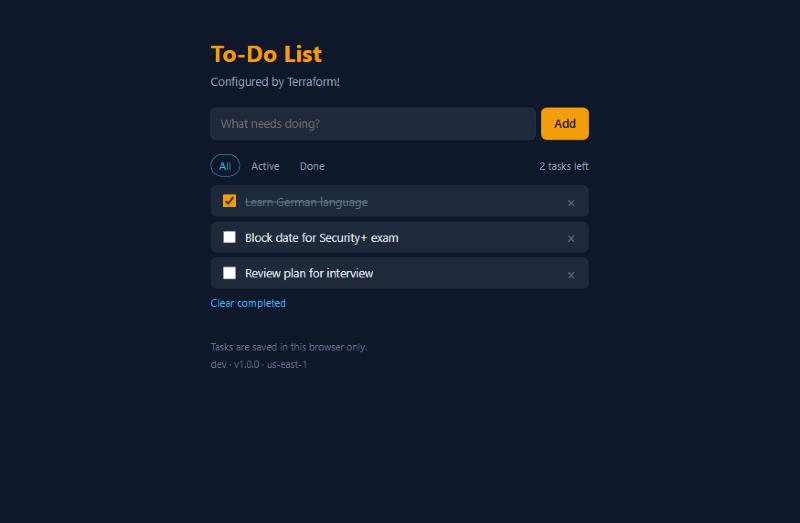
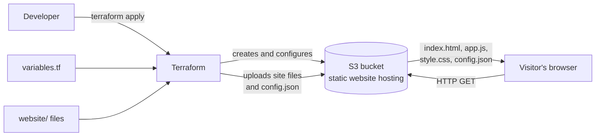

# To-Do List on AWS S3, deployed with Terraform

[](https://github.com/ashwinikrishna2025-sketch/aws-s3-static-website/actions/workflows/terraform.yml)

A small to-do list web app hosted on **Amazon S3**, where every AWS resource is
defined as code with **Terraform**. One command creates the whole site, another
deletes it, and a change to a Terraform variable flows through to what the page
shows.

**Live demo:** <http://my-static-site-953910e1.s3-website-us-east-1.amazonaws.com>
(use `http://` - S3 website endpoints do not support HTTPS)



## What this project demonstrates

- **Infrastructure as code** - the bucket, website hosting, access policy and
  file uploads are all declared in Terraform, with no console clicks.
- **Least-surprise public access** - public ACLs stay blocked; a bucket policy
  grants read-only access to the site files and nothing else.
- **Configuration flowing from infrastructure to the app** - Terraform variables
  are rendered into a `config.json` that the page loads at runtime.
- **Safe change workflow** - `fmt`, `validate`, `plan`, then `apply`, with changes
  made on branches and merged through pull requests.
- **Remote state** - Terraform's state lives in a private, versioned, encrypted
  S3 bucket with state locking, instead of a file on one machine.
- **Continuous integration** - a GitHub Actions workflow checks formatting and
  validates the configuration on every push and pull request.

## Architecture



## The app

The site is a small **to-do list**: add tasks, tick them off, filter by
All / Active / Done, and clear completed ones. It runs entirely in the browser,
so tasks are saved in that browser's local storage - there is no server or
database. It is plain HTML, CSS and JavaScript with no build step.

## What it creates

| Resource | Purpose |
| --- | --- |
| `aws_s3_bucket` | Stores the website files (name gets a random suffix so it's globally unique) |
| `aws_s3_bucket_website_configuration` | Turns on S3 static website hosting (`index.html` / `error.html`) |
| `aws_s3_bucket_public_access_block` | Allows a public read policy, still blocks public ACLs |
| `aws_s3_bucket_policy` | Lets anyone **read** (not change) the files |
| `aws_s3_object` | Uploads everything in `website/` with the right content type, plus the generated `config.json` |

## Project layout

```
.
├── .github/workflows/        # CI: terraform fmt + validate on every push and PR
├── bootstrap/                # One-time setup: creates the S3 bucket for Terraform state
├── docs/                     # Screenshot used in this README
├── versions.tf               # Terraform + provider versions, state backend, AWS provider settings
├── variables.tf              # Inputs (region, project name, app settings)
├── main.tf                   # The S3 bucket, website config, policy, file uploads, config.json
├── outputs.tf                # Prints the bucket name, website URL and app config
├── terraform.tfvars.example  # Copy to terraform.tfvars to set your own values
└── website/                  # The site itself - edit these files
    ├── index.html            # The to-do list page
    ├── app.js                # The to-do list logic (runs in the browser)
    ├── error.html
    └── style.css
```

## Prerequisites

1. An AWS account.
2. [Terraform](https://developer.hashicorp.com/terraform/install) 1.10 or newer.
3. AWS credentials on your machine. The easiest way is the
   [AWS CLI](https://aws.amazon.com/cli/) and `aws configure`, using an access key
   from an **IAM user** (not your root account) with S3 permissions.

## Deploy

```bash
# 1. One time only: create the bucket that stores Terraform's state
cd bootstrap
terraform init
terraform apply          # prints state_bucket_name
cd ..

# 2. Put that bucket name in the backend "s3" block in versions.tf

# 3. (Optional) set your own name/region
cp terraform.tfvars.example terraform.tfvars

# 4. Download the AWS provider and connect to the state bucket
terraform init

# 5. Preview what will be created - nothing changes yet
terraform plan

# 6. Create it (type "yes" when asked)
terraform apply
```

When it finishes, Terraform prints `website_url`. Open it in your browser.

## Update the site

Edit any file in `website/`, then run `terraform apply` again. Only the changed
files are re-uploaded.

## App configuration

Terraform also generates a small `config.json` from the `app_environment`,
`app_version` and `welcome_message` variables and uploads it with the site. The
home page loads that file and shows the values.

To change a value, set it in `terraform.tfvars` (or pass it on the command line)
and apply:

```bash
terraform plan -var "app_environment=test"
terraform apply -var "app_environment=test"
```

## Remote state

Terraform records what it has created in a *state file*. Here that file is
stored in S3 rather than on one machine:

| Setting | Why |
| --- | --- |
| Separate, private bucket | State can contain sensitive values, so it is never public |
| Versioning | Every earlier state is kept (for 90 days), so a bad change can be rolled back |
| Encryption at rest | The file is encrypted in S3 |
| `use_lockfile = true` | Locks the state during a command, so two runs can't collide |

The state bucket is created by the small config in `bootstrap/`, which keeps its
own state locally. It is deliberately separate: the main project can't create
the bucket it stores its own state in.

## Tear it down

```bash
terraform destroy
```

This deletes the website bucket and every file in it. The state bucket is left
in place on purpose (it has `prevent_destroy`); delete it from the S3 console if
you want everything gone.

## Cost

S3 storage and requests for a small site like this are within the AWS Free Tier
for new accounts and cost cents at most otherwise. Still, run `terraform destroy`
when you're done experimenting.

## Troubleshooting

- **`AccessDenied` when creating the bucket policy** - your AWS account may have
  *account-level* "Block Public Access" turned on. Check
  S3 console → *Block Public Access settings for this account*.
- **`No valid credential sources found`** - run `aws configure` (or set
  `AWS_ACCESS_KEY_ID` / `AWS_SECRET_ACCESS_KEY` environment variables).
- **Site shows `403 Forbidden`** - wait a minute after `apply`; the policy can take
  a moment to apply.

## Continuous integration

`.github/workflows/terraform.yml` runs on every push to `main` and every pull
request. It checks formatting with `terraform fmt -check` and correctness with
`terraform validate`. It needs no AWS credentials and never deploys anything.

## Possible next steps

- Add **CloudFront** in front of the bucket for HTTPS and caching, and make the
  bucket private.
- Use a custom domain with **Route 53**.
